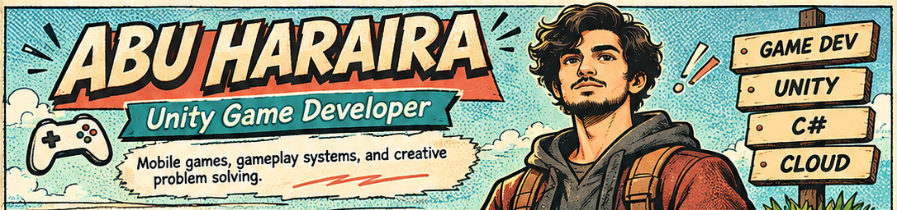
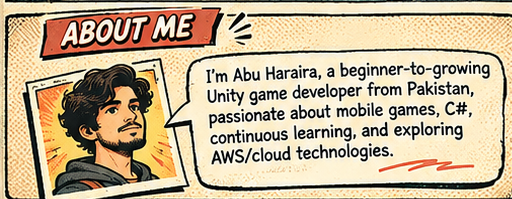
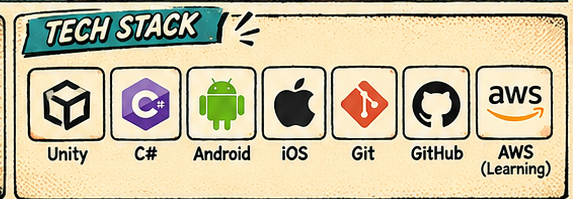
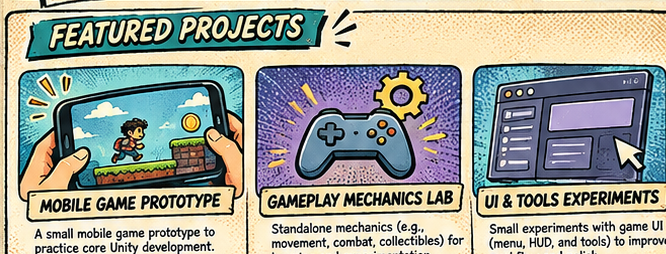
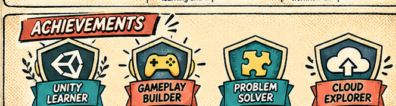
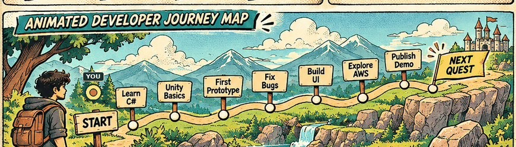

**🎮 Unity Game Developer • C# • Mobile Games • Learning Cloud**

*Learning by building. One game mechanic at a time.*

<table><tr><td width="50%" valign="top"></td><td width="50%" valign="top"></td></tr></table>

### 🎯 Current quests

- 🎮 Build fun interactive experiences with **Unity and C#**.
- 📱 Improve mobile gameplay systems and user interfaces.
- 🛠️ Practice clean C# code, optimization, and debugging.
- ☁️ Explore how AWS and cloud services can support games.

### 🧩 Project ideas & experiments

> **Concept art only:** These are examples of projects and experiments to showcase in the future, **not links to published repositories**. I'll add public project links, gameplay captures and source details as they become available.

### 📊 GitHub activity

> Stats use an external service and may occasionally be unavailable. Language percentages reflect public repositories, not overall developer proficiency.

### 🏅 Skill paths

*Illustrative skill themes — not certification claims or automatically unlocked achievements.*

### 🗺️ My Developer Journey — animated map

The little marker travels along a comic-style learning path, from practicing C# and Unity to building and sharing games. This is a custom decorative animation, **not** a GitHub contribution counter.

### 🤝 Multiplayer lobby — connect

<!-- Add your real LinkedIn and email URLs here when ready; do not publish placeholder contact details. -->

**NEXT QUEST: KEEP LEARNING • KEEP BUILDING • KEEP PLAYING** 🎮

