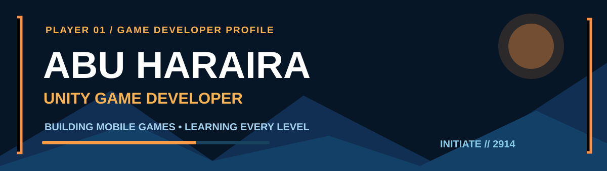
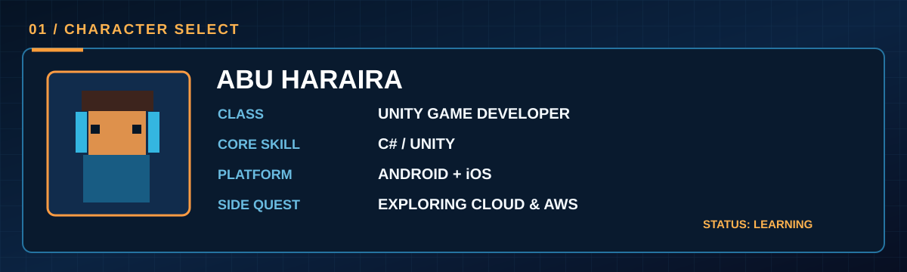
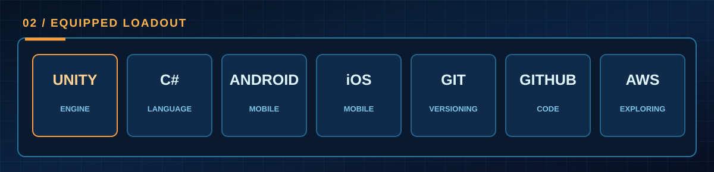
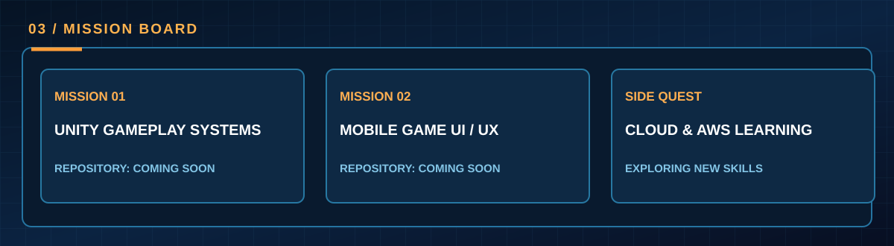
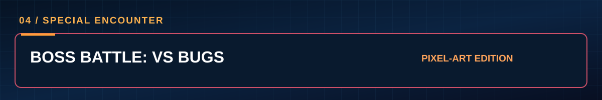
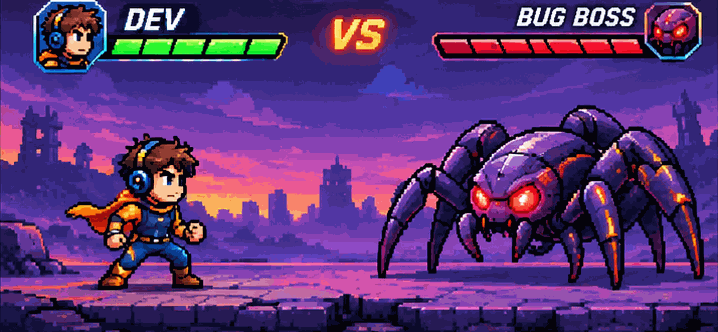
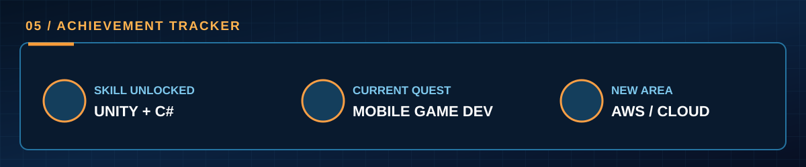

<!-- GitHub profile repository: https://github.com/AbuHaraira2914/AbuHaraira2914 -->

### 🎮 PLAYER BIO

I'm **Abu Haraira**, a Unity game developer interested in mobile game development, interactive gameplay, and creative problem solving. I'm continually improving my **Unity and C#** skills and exploring **AWS and cloud technologies**.

### ⚡ PLAYER STATS — LIVE GITHUB DATA

> Stats are generated by an external service and may temporarily fail or show limited information for a new profile.

### 🗺️ QUEST LOG

The mission cards above are **portfolio placeholders**, not claims that public project repositories already exist. As you publish your projects, edit this section to add real repository URLs, gameplay clips, and screenshots.

**DEBUG MODE: ON** · A custom six-frame looping pixel-art battle, not a contribution snake.

### 🤝 MULTIPLAYER LOBBY

<!-- When ready, add your real LinkedIn URL here. -->
<!--  -->

