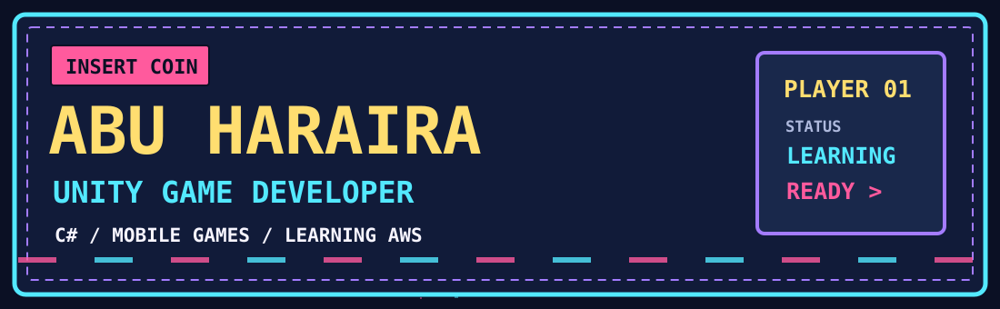
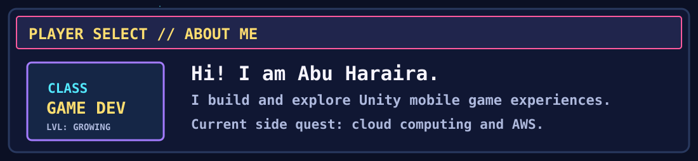
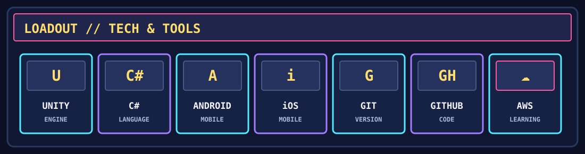
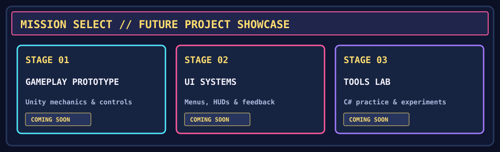
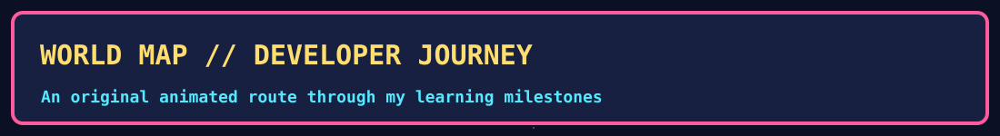
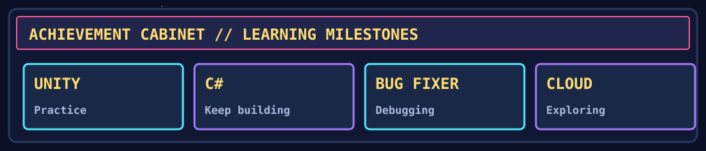
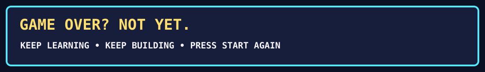

I'm **Abu Haraira**, a Unity game developer interested in **mobile gameplay, game systems, and creative problem-solving**. I enjoy building with **C#** and exploring **AWS/cloud technologies** as a learning goal.

### 🏆 HIGH SCORES // LIVE GITHUB STATS

> **Project slots are placeholders, not links to finished repositories.** I'll add my real Unity projects, playable builds, screenshots and code samples here as they become public.

*An original looping pixel-art journey animation — not a contribution snake or real-time progress tracker.*

These are **learning themes**, not verified certifications or earned trophies. I'm focused on improving in Unity, C#, debugging, and exploring cloud services.

### 🎮 MULTIPLAYER LOBBY // CONNECT

<!-- Add a verified LinkedIn link here when available. -->

